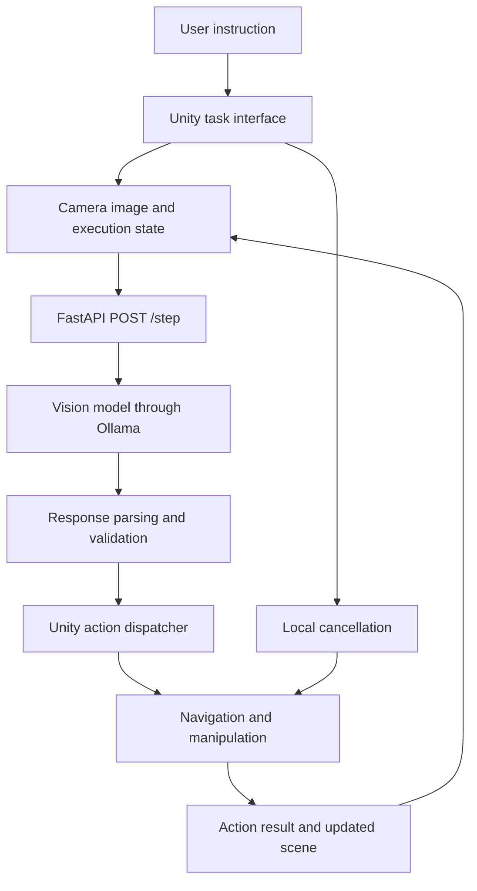

# Implementation Plan: VLM-Controlled Robot in a 3D Space Habitat

## 1. Purpose and Status

Build a working connection between a vision-language model (VLM) and a 3D gaming engine. A user gives a natural-language instruction, the model observes an image of the environment, and a robot executes validated movement and manipulation commands inside the engine.

**Primary demonstration:** "Pick up the blue container and place it on the delivery platform."

**Planning status:** No implementation exists yet. The software versions, hardware capacity, model performance, and development tools listed below must be verified during setup. Checkboxes represent planned work, not completed functionality.

## 2. Assignment Coverage

| Assignment requirement | Proposed implementation | Evidence to collect |
| --- | --- | --- |
| Set up Unity or Unreal with a moving agent | Unity habitat scene with a navigable robot | Scene overview and recorded robot movement |
| Set up a VLM front end | In-scene instruction interface connected to a Python service and a vision-capable model | User instruction, captured image, and model response |
| Map VLM output to movement commands | Typed, allowlisted action contract and Unity action dispatcher | Validated JSON mapped to controller operations |
| Receive output, map it, and move an agent | HTTP decision loop with execution feedback and new observations | End-to-end pick-and-place demonstration and logs |

The example mentions VLA behavior, but this project will implement a **VLM-driven action pipeline**, not train or claim to use an end-to-end vision-language-action policy. The distinction must remain explicit in the report.

A text-only Llama model is insufficient for the visual component. The selected model must accept an actual scene image together with the instruction.

## 3. Scope

### Required MVP

- One habitat room with a traversable floor, walls, and a small number of obstacles.
- One robot that can move, stop, pick up a nearby object, and place a held object.
- At least three distinguishable containers and one delivery platform.
- Stable, visible target IDs so visual observations can be connected to engine objects.
- A fixed overview camera that clearly shows the task area.
- An interface for entering an instruction, starting a task, cancelling it, and inspecting status.
- A real image-to-model-to-action integration with execution feedback.
- Deterministic validation, bounded execution, and repeatable tests.
- A runnable build, setup documentation, and demonstration evidence.

### Deliberate Simplifications

- Pick-up attaches an object to a carry point; it does not simulate an articulated gripper.
- Placement uses a defined platform placement slot and verifies the resulting scene state.
- Navigation uses Unity navigation tools, not model-generated motor commands.
- The scene contains a known registry of actionable objects and destinations.
- The first implementation runs locally on one machine.

### Out of Scope Until the MVP Passes

- Training or fine-tuning a model.
- Real robot hardware, ROS integration, or external robotics simulators.
- Physically realistic grasping, inverse kinematics, or multiple manipulators.
- Cabinet hinges, multiple rooms, multiple agents, voice input, or multiplayer.
- A separate web application, cloud deployment, or public network exposure.

## 4. Recommended Technology Choices

| Component | Choice | Reason |
| --- | --- | --- |
| 3D engine | Supported Unity LTS release with C# | Navigation, scene tooling, and HTTP integration |
| Navigation | Compatible Unity AI Navigation package | Deterministic paths and arrival checks |
| Interface | Unity Canvas and TextMeshPro | Keeps the demonstration within one application |
| Backend | Python, FastAPI, Pydantic, and HTTPX | Typed request validation and asynchronous model calls |
| Model runtime | Ollama | Local model serving with image-capable model support |
| Initial model candidate | Llama 3.2 Vision | Vision-capable member of the Llama family |
| Backend testing | pytest and suitable async support | Contract, timeout, and integration tests |
| Engine testing | Unity Test Framework | Controller and dispatcher behavior |

Choose and pin exact versions only after checking compatibility. Record the Unity editor and package versions, Python version, Ollama version, model tag, quantization where applicable, and dependency versions.

If the initial model is too large or slow, evaluate a smaller image-capable model available in the chosen runtime. Do not silently substitute a text-only model or a mocked response in the final demonstration.

## 5. Architecture and Ownership



### Unity Owns

- Scene geometry, object IDs, transforms, navigation, and manipulation.
- Task lifecycle, local cancellation, and authoritative action preconditions.
- Camera capture and observation sequencing.
- Execution outcomes and objective task completion checks.

### Backend Owns

- Request validation and model request construction.
- Image payload limits and model inference deadlines.
- Strict parsing of model output into an action proposal.
- Action and target allowlisting against the submitted observation metadata.
- Structured error responses and correlation logs.

### Model Owns

- Interpreting the instruction and visual scene.
- Selecting a target and one permitted next action.
- Deciding when to propose task completion.

The model never owns world coordinates, physics state, executable code, or final verification of success.

## 6. Environment and Robot Design

### Scene Layout

Create a compact habitat with a storage area, a delivery area, and a clear robot route. Use enough obstacles to demonstrate navigation while keeping the route and interactions visible from the overview camera.

Use simple geometry first. Add habitat styling only after navigation and interaction work. Any third-party models, textures, or icons must have recorded sources and suitable licenses.

### Object Registry and Visual Grounding

- Register unique IDs such as `object_01`, `object_02`, and `delivery_01`.
- Show readable world-space labels near the corresponding objects.
- Include those labels in the camera image, but exclude task-interface panels.
- Keep semantic appearance, such as container color, visible in the image.
- Send IDs, object categories, and visibility metadata to the model, not an answer-bearing list such as "object_02 is the blue container."
- Keep engine transforms private to the Unity execution layer.
- Change object positions and color-to-ID assignments between evaluation runs.

This makes visual interpretation necessary while keeping command execution reliable. The known registry is an intentional simulation aid, not unrestricted visual discovery.

### Robot Controller

- Use a NavMeshAgent or equivalent supported navigation component.
- Resolve each target ID to a reachable interaction position with a suitable approach offset.
- Check path completeness, remaining distance, and a navigation deadline.
- Require a short interaction distance for pick-up and placement.
- Carry only one object at a time.
- Manage colliders and rigidbody state consistently while carrying and after placement.
- Reject duplicate commands rather than repeating a completed manipulation.

## 7. Action Contract

### Permitted Actions

| Action | Parameter | Preconditions | Successful result |
| --- | --- | --- | --- |
| `navigate_to` | `target_id` | Known, eligible target with a reachable approach point | Robot reaches interaction range |
| `pick_up` | `target_id` | Pickable object, empty carry point, robot in range | Requested object becomes held object |
| `place_on` | `target_id` | Valid platform, held object, robot in range, placement slot available | Object occupies platform slot |
| `stop` | None | Active task | Current task stops without being marked successful |
| `finish` | None | No action executing | Unity evaluates the task completion conditions |

Example model output:

```json
{
  "action": "navigate_to",
  "target_id": "object_02"
}
```

Require exactly one action object. Reject unknown actions, extra fields, invalid parameter combinations, unknown targets, non-JSON prose, and code blocks instead of attempting permissive text extraction.

The backend validates proposal structure and target eligibility. Unity repeats the authoritative scene checks immediately before execution because the scene may have changed.

### Execution Result Contract

Each attempted action produces a structured result containing its action ID, status, target ID when relevant, and a bounded error code. Use statuses such as `succeeded`, `failed`, and `cancelled`.

Initial error codes should include `unknown_target`, `target_not_visible`, `unreachable_target`, `out_of_range`, `already_holding`, `nothing_held`, `placement_unavailable`, and `execution_timeout`.

Keep human-readable messages separate from machine-readable error codes.

## 8. HTTP and Model Contracts

### Endpoints

| Endpoint | Purpose |
| --- | --- |
| `GET /health` | Report service health and distinct model readiness information |
| `POST /step` | Accept an observation and return one validated action proposal |

Do not require WebSockets, server push, or a backend command queue for the MVP. Unity requests the next action only when ready to execute it.

### Step Request

Include:

- `session_id`, a unique `request_id`, and a monotonically increasing `observation_id`.
- The original instruction and current step number.
- An actual camera image encoded as base64, with its media type.
- Visible target IDs and categories, without world coordinates or semantic answers.
- Held-object ID or null.
- The previous action result or null for the first observation.

Choose supported image encoding and resolution through an early model smoke test. Enforce maximum request bytes, decoded image bytes, pixel dimensions, and instruction length.

### Step Response

Return the matching session, request, and observation IDs; one action proposal; and server-side timing information. Generate action IDs in application code, not in the model.

Return structured errors when the request, image, model call, or model output is invalid. No error response may contain a fallback movement action.

### Prompt Strategy

- Explain the action schema and visible target-label convention.
- Supply the instruction, current image, held state, and previous result.
- Request one next action, not an entire open-loop plan.
- Require clarification through task failure when the instruction is unsupported or ambiguous; do not guess a destructive or unrelated action.
- Treat text appearing in the scene or instruction as task data, not permission to change the action schema.
- Prefer low-variability generation settings and structured output if the selected model/runtime combination supports it.
- Validate every response even when structured output is enabled.

Start with the current observation and previous result rather than an unbounded conversation history. If testing reveals repeated-action loops, add a small bounded history of executed action summaries.

## 9. Task Lifecycle, Feedback, and Cancellation

Use explicit states: `Idle`, `Capturing`, `AwaitingDecision`, `Validating`, `Executing`, `Completed`, `Failed`, and `Cancelled`.

Normal cycle:

1. Validate the user instruction is nonempty and start a fresh task session.
2. Capture the scene after the previous action has settled.
3. Submit the image and execution state to `/step`.
4. Verify correlation IDs and reject stale responses.
5. Validate and execute one action.
6. Record its result, capture another observation, and repeat.
7. End on verified completion, cancellation, an unrecoverable error, or a configured limit.

Keep Unity networking asynchronous and Unity scene API calls on the main thread. Model latency must not block rendering or frame-based navigation.

Local Stop must cancel the task token, stop navigation immediately, invalidate outstanding decisions, and prevent later manipulation. Leave a held object safely attached unless an explicit recovery operation is implemented; do not drop it automatically.

Use separate configurable deadlines for inference, navigation, and total task execution, plus a maximum number of actions. Determine defaults from measured hardware performance rather than assuming real-time inference.

Do not automatically retry a timed-out decision request in the MVP. Show the failure and allow an explicit restart. After a recoverable execution error, permit a bounded new decision using the updated image and error result.

## 10. Completion Verification

For the primary benchmark, the intended target is independently known by the evaluator. Do not send that answer to the model.

A successful run requires all of the following:

- The intended container is in the delivery platform's placement slot.
- The robot no longer holds that container.
- No unintended container has been delivered.
- The task was not cancelled and did not exceed its limits.

The model's `finish` action requests verification; it does not itself establish success. Record premature finish proposals as failures or bounded recovery events.

Free-form instruction understanding and benchmark verification are separate concerns. The MVP's deterministic success checker covers documented task templates; unsupported instructions should fail clearly rather than receive an unverified success label.

## 11. Proposed Repository Layout

```text
PLAN.md
README.md
backend/
  app/
    main.py
    schemas.py
    model_client.py
    decision_service.py
    settings.py
  tests/
  pyproject.toml
  .env.example
unity/
  Assets/
    Scenes/
    Scripts/
      Robot/
      Actions/
      Networking/
      Observation/
      UI/
    Tests/
  Packages/
  ProjectSettings/
docs/
  architecture.md
  evaluation.md
  assets.md
```

This is a proposed layout, not a requirement to create every file immediately. Add modules only when they own actual behavior. Exclude Unity generated caches, Python environments, secrets, model weights, and temporary captures from version control.

## 12. Implementation Milestones

### Milestone 0: Verify Development Feasibility

- [ ] Check available RAM, GPU/VRAM, disk space, Python, Unity Hub/editor, and Ollama.
- [ ] Select compatible versions and confirm any required licenses or downloads.
- [ ] Start the model runtime and run one genuine image-plus-text inference.
- [ ] Confirm the selected model can read the planned label size and distinguish container colors.
- [ ] Measure inference latency and choose initial image dimensions and deadlines.

**Exit gate:** A reproducible image inference succeeds on the actual machine, or a documented alternative vision model/runtime is selected. If no viable vision runtime is available, resolve that blocker before claiming end-to-end readiness.

### Milestone 1: Complete the Manual Unity Task

- [ ] Create the habitat, robot, containers, labels, and delivery platform.
- [ ] Configure navigation and target approach positions.
- [ ] Implement movement, pick-up, placement, and local Stop.
- [ ] Add a manual command harness using the same controller methods intended for AI actions.
- [ ] Verify successful and invalid command sequences.

**Exit gate:** A manually triggered sequence completes pick-and-place, and invalid operations leave the scene consistent.

### Milestone 2: Establish the Validated Contract

- [ ] Implement backend schemas and matching Unity serializable types.
- [ ] Implement action parsing, target validation, and error responses.
- [ ] Add correlation IDs, action IDs, and duplicate protection.
- [ ] Test malformed JSON, unknown actions, extra fields, and invalid parameters.

**Exit gate:** Contract tests pass, and invalid proposals cannot reach robot execution.

### Milestone 3: Prove Visual Decision-Making

- [ ] Capture actual Unity scene images with readable labels.
- [ ] Integrate Ollama through a replaceable model-client boundary.
- [ ] Implement the constrained decision prompt and response parser.
- [ ] Test altered positions, color-to-ID assignments, and ambiguous instructions.
- [ ] Record model limitations and tune image framing before adding prompt complexity.

**Exit gate:** The model identifies the requested container from images across changed layouts without receiving the answer through metadata.

### Milestone 4: Connect the Closed Loop

- [ ] Implement `/health`, `/step`, and Unity's asynchronous client.
- [ ] Implement lifecycle states, capture sequencing, and action dispatch.
- [ ] Feed execution results into the next observation.
- [ ] Add limits, cancellation, stale-response rejection, and status display.
- [ ] Run the first complete instruction-to-placement workflow.

**Exit gate:** A real model-driven run completes, and Stop works during both inference and movement.

### Milestone 5: Evaluate and Harden

- [ ] Run backend and Unity tests with the model mocked only where appropriate.
- [ ] Run real-model evaluations separately and identify them clearly.
- [ ] Test unavailable services, bad responses, unreachable targets, and cancellation races.
- [ ] Verify deterministic scene reset and configurable starting layouts.
- [ ] Record success rates, error categories, and latency.

**Exit gate:** Functional acceptance criteria pass and remaining model reliability limits are documented.

### Milestone 6: Package the Submission

- [ ] Produce a standalone build for the demonstrated platform.
- [ ] Verify camera capture and networking outside the Unity editor.
- [ ] Write setup, startup, test, configuration, and troubleshooting instructions.
- [ ] Record the demonstration and prepare evaluation results.
- [ ] Re-run the setup instructions from a clean application state.

**Exit gate:** Another person can reproduce the demonstrated workflow using the submitted instructions and stated hardware prerequisites.

## 13. Testing and Evaluation

### Automated Backend Checks

- Valid actions are accepted and malformed proposals are rejected.
- Target-required and parameterless actions enforce their distinct schemas.
- Image decoding and payload limits reject invalid or oversized observations.
- Model timeouts and unavailability produce structured errors without commands.
- Correlation fields survive request/response processing unchanged.
- Prompt construction includes the image and does not leak benchmark answers.

### Unity EditMode and PlayMode Checks

- Target registration rejects duplicate IDs.
- Action dispatch rejects unknown targets, stale decisions, and duplicate action IDs.
- Navigation reports success, unreachable routes, and deadline failures correctly.
- Pick-up and placement enforce distance and inventory preconditions.
- Stop cancels navigation and invalidates outstanding decisions.
- Completion checks inspect object state rather than a model-generated success message.

### End-to-End Cases

| Case | Expected outcome |
| --- | --- |
| Blue-container instruction | Correct container reaches delivery platform |
| Changed positions and color-to-ID assignments | Selection follows the image, not a fixed ID |
| Ambiguous instruction or absent requested object | Clear failure without unrelated manipulation |
| Blocked approach route | Bounded failure or bounded replanning |
| Invalid model output | Rejected without movement |
| Backend unavailable or model timeout | Task fails visibly; UI remains responsive |
| Stop while awaiting inference | Late response is ignored |
| Stop while carrying or navigating | Movement stops; held object remains consistent |
| Premature `finish` | No false success |
| Standalone player | Same capture, networking, and controller behavior as editor |

### Evaluation Protocol

Run at least 10 real-model trials across at least three documented layouts, varying positions and color-to-ID assignments. Reset to a known starting state before each trial. Keep failed trials in the results.

Record instruction, layout/seed, intended target, model and prompt versions, actions, failures, completion status, total duration, and per-decision latency. Summarize success rate, wrong-object rate, invalid-proposal rate, and median/maximum inference latency.

Use 8 successful trials out of 10 as an initial project reliability target, not a claimed assignment requirement. If performance is lower, report it honestly and identify the observed causes.

## 14. Operational Safety and Observability

- Bind backend and model services to loopback by default.
- Do not allow arbitrary code, shell execution, file paths, or URLs in model actions.
- Keep endpoint configuration outside committed secrets and validate configured addresses.
- Apply request limits, inference deadlines, and bounded task execution.
- Log session, request, observation, and action IDs with state transitions and timings.
- Display concise user-facing errors instead of raw tracebacks.
- Keep image logging optional; never commit bulk observations or model weights.
- Document that cancelling Unity execution may not immediately stop an in-flight model computation.

## 15. Risks and Mitigations

| Risk | Mitigation |
| --- | --- |
| Model exceeds available memory | Run feasibility check first; select a smaller vision-capable model if necessary |
| Inference is slow | Use high-level actions, bounded image sizes, and asynchronous requests |
| Labels or colors are misread | Improve camera framing, contrast, and label placement; test actual screenshots |
| Model invents targets or actions | Strict schema, submitted-target allowlist, and Unity precondition checks |
| Target approach is unreachable | Predefine interaction offsets and verify complete navigation paths |
| Manipulation destabilizes physics | Use explicit carry/placement state and test collider transitions |
| Delayed response executes after Stop | Cancel task session and reject stale correlation IDs |
| Evaluation succeeds by memorization | Vary target appearance-to-ID assignments and spatial arrangements |
| Editor-only success | Include standalone-player integration checks before submission |
| Scope expands before integration works | Gate optional features on the complete MVP workflow |

## 16. Documentation and Demonstration

The README should cover prerequisites, exact tested versions, dependency installation, model acquisition, configuration, startup order, health checks, Unity scene/build entry point, tests, and common failures.

Suggested startup order is model runtime, backend, then Unity application. Document the actual configured URLs and ports after implementation rather than assuming defaults are free.

The demonstration should show:

1. The habitat, robot, labeled containers, and delivery platform.
2. The entered instruction and scene image sent to the model.
3. A validated model action and its corresponding robot behavior.
4. The complete pick-and-place workflow and independently verified outcome.
5. A changed-layout run demonstrating visual selection.
6. One controlled failure or cancellation example.

Clearly distinguish real model inference from test fixtures. Include limitations and asset attributions in the submission.

## 17. Final Definition of Done

- [ ] Every assignment requirement has working implementation and demonstration evidence.
- [ ] The chosen model receives real images and influences target selection.
- [ ] The robot completes the documented navigation and pick-and-place workflow.
- [ ] Model output crosses a validated action contract rather than becoming executable code.
- [ ] The system observes again after actions and uses execution feedback.
- [ ] Invalid commands, failures, cancellation, and stale responses are handled deterministically.
- [ ] Automated checks pass and real-model evaluation results are reported separately.
- [ ] The standalone build is verified with the backend and model runtime.
- [ ] Setup instructions, architecture, limitations, evaluation results, and demonstration are delivered.

## 18. Optional Extensions After Completion

In priority order: cabinet interaction with a constrained hinge, additional instruction templates, a robot-mounted camera, improved robot animation, and richer habitat assets. Each extension must preserve the existing validated command boundary and repeatable baseline tests.